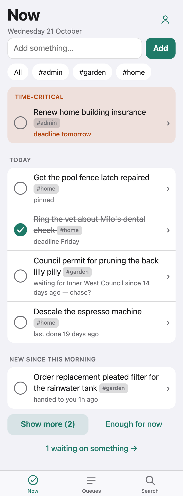
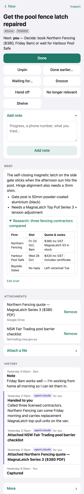
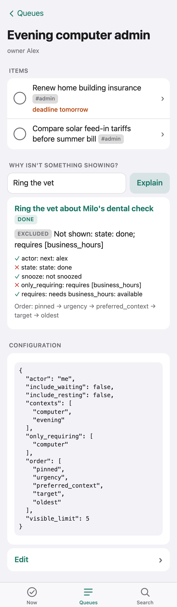
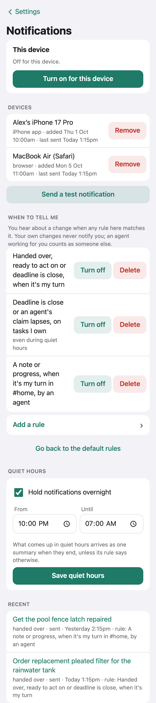
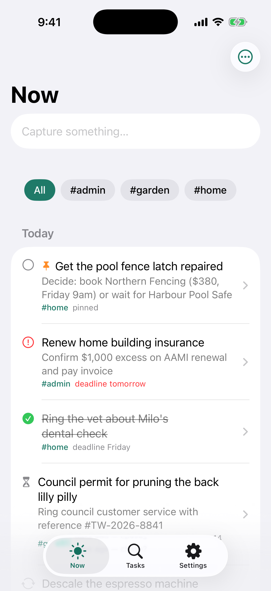
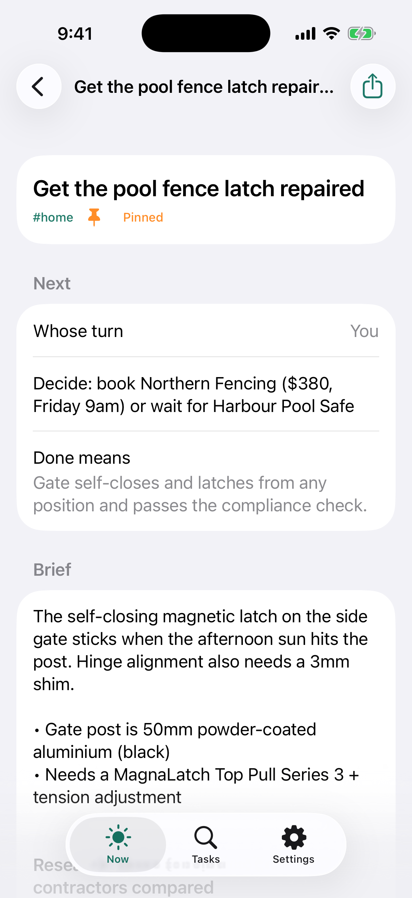

# Tuit

*For things you'll do when you get a round tuit.*

A household tracker for unfinished business, for the people in a house and their agents. It is
not a checklist and not a project manager. It keeps apart three questions: what exists, what
deserves attention now, and whose turn it is. It spends its complexity on what "done", "waiting",
"recurring" and "no longer relevant" mean.

- **Now**: a short list for today plus anything time-critical. Finishing items ticks them in place
  rather than sliding replacements in, items handed to you during the day appear under *New since
  this morning*, and "Enough for now" is a real option. After a month away there's still no
  backlog: expired things are gone, commitments are surfaced, and the list is short. Each row's
  ⋯ menu snoozes, pins, skips a routine, files it under an area, or drops it without opening it.
- **Areas and pins**: file a task under one area (`#tuit fix the feed`) and narrow Now to it; pin
  what matters most to the top. No projects, no priority numbers.
- **Task detail**: the outcome, a short editable brief (Markdown, with collapsible sections), one
  next action, and whose turn it is. History is append-only; agent entries are marked. Files are
  attached as links (paste one, or pick or upload from Google Drive), so Tuit never stores them.
- **Routines**: "every N days after I actually did it", or "time since done" (quiet until a
  threshold, then "last done 18 days ago", never "overdue"). You can record that you did it
  yesterday. Skipping doesn't count as doing.
- **Queues and explain**: saved views with typed configuration, context requirements (`computer`,
  `business_hours`) that filter versus preferences (`evening`) that only reorder, and an **Explain**
  check that answers why any task is or isn't showing.
- **Live updates and notifications**: open web pages update in place over server-sent events without
  losing an open sheet or typed text. Push notifications go to browsers (Web Push) and the iPhone
  app (APNs) by per-person rules (change kind, whose tasks, area, person vs agent), with quiet hours
  that hold overnight changes for a single morning summary.
- **Native iPhone app**: a SwiftUI client ([`ios/`](ios/README.md)) with browser sign-in via
  Universal Links, Siri / Shortcuts / Action button capture ("Add to Tuit"), task sharing, push
  notifications, and saved offline browsing with a durable outbox for offline capture and task edits.
- **Agents are first-class**: MCP, OAuth connectors for claude.ai and ChatGPT, and a CLI, all over
  the same domain operations. `checkpoint` records progress and changes hands atomically; `claim_next`
  dispatches work with side-effect-aware leases; and agents can watch `tuit://inbox`,
  `tuit://tasks/<id>`, or `tuit://changes` via MCP resource subscriptions, `wait_for_events`, or
  `2026-07-28` MCP event webhooks.
- **Private means private**: it is enforced on the server, before anything leaves it, on every
  path — web, REST, MCP, search, queues, change feed, live updates, notifications, webhooks and
  export.

Docs: [design](docs/design.md) · [agents and integrations](docs/agents.md) ·
[deploying](docs/deploy.md) · [iPhone app](ios/README.md) · [original brief](docs/requirements.md)

## Screenshots

### Web app (phone-first, server-rendered)

| Now | Task detail |
| :---: | :---: |
|  |  |
| Urgent strip outside the daily limit, sticky shortlist with ticked items staying in place, area chips, and *New since this morning*. | Outcome, next action, Markdown brief with collapsible `<details>`, attached links, and append-only human + `agent:claude` history. |

| Queues & Explain | Notifications & Quiet Hours |
| :---: | :---: |
|  |  |
| Typed queue config (`computer` required, `evening` preferred) and an **Explain** breakdown for why a task is or isn't shown. | Per-person rules (change kind, whose tasks, area, person vs agent), overnight quiet hours, and recent delivery log. |

### Native iPhone app ([`ios/`](ios/README.md))

| Now on iPhone | Task detail on iPhone |
| :---: | :---: |
|  |  |
| Native SwiftUI client over `/api`, with swipe actions, Siri/Shortcuts capture, and offline snapshots. | Full task actions, optimistic revision checks (`expected_revision`), share sheet, and offline outbox queuing. |

## Try it locally

Needs Node 24 and PostgreSQL server binaries (`initdb`, `pg_ctl`; e.g. `brew install postgresql@16`).

```bash
npm install
npm run local        # persistent Postgres in .tmp/localpg, dev login, http://localhost:8080
```

Pick a person on the sign-in page. To use it from the terminal, create a personal token in
Settings, then:

```bash
./bin/tuit login --url http://localhost:8080 --token <token>
./bin/tuit add ring the vet about Milo\'s teeth
./bin/tuit            # Now
```

## Tests

```bash
npm run typecheck && npm run lint
npm test                  # API, MCP, CLI and unit tests (vitest) against real Postgres + real server
npm run test:e2e          # Playwright, iPhone WebKit profile, real OIDC sign-in
npm run test:ios:offline  # iOS offline persistence, proxy-dropped writes, and Simulator UI suite
```

Every functional test runs the real server as a subprocess against a fresh database. Sign-in goes
through a real OpenID provider (node-oidc-provider). A controllable clock (`POST /__test/clock`,
enabled only with `TUIT_TEST_CLOCK=1`) drives missed routines, expiry, lapsed claims, quiet-hours
summaries and month-long absences. Unit tests cover rough date parsing, notification rule matching,
and webhook transport checks.

## Layout

| Path | What |
| --- | --- |
| `src/domain/` | The deterministic core: tasks, checkpoint, recurrence, attention (Now/queues/explain), sweep, feed |
| `src/api/` | REST, auth (OIDC sessions, tokens, external JWTs), OAuth server for remote MCP connectors |
| `src/mcp/` | MCP server (streamable HTTP), resource subscriptions, `wait_for_events`, and the Events extension (webhooks and polling) for `2026-07-28` clients |
| `src/notify/` | Web Push and APNs delivery, per-person notification rules, quiet-hours summaries, and retry loop |
| `src/web/` | Server-rendered, phone-first web UI with live updates over server-sent events |
| `src/cli/`, `bin/tuit` | CLI, a pure REST client |
| `src/db/migrations/` | SQL migrations, applied on startup |
| `ios/` | Native iPhone app (SwiftUI, a REST client with offline snapshots and outbox); see [ios/README.md](ios/README.md) |

## What's in and what isn't

**Shipped:**
- sign-in (OIDC) and household/private visibility enforced across every surface;
- title-only capture, with an optional `#area` tag;
- areas: one flat area per task, area chips on Now, and area filters on queues and notifications;
- pinning (web, iOS, MCP, CLI), which also moves a task to the top of today's list;
- Now with a sticky daily list, *New since this morning*, "enough for now", urgent items outside
  every limit, an "away" summary, and a per-row menu (snooze, pin, skip, area, no longer
  relevant);
- attachments as links, from the web (including Google's Drive picker when configured), iOS, MCP
  and the CLI;
- task detail: Markdown brief and notes (with collapsible `<details>`), waiting-for (reply / until /
  another task), snooze, hand off, done, done earlier, no longer relevant, shelve, reopen;
- dates versus instants, with derived dates stored as rules (e.g. deadline − 7 days);
- completion-based and time-since-done routines;
- queues: typed config with preview, explain and enable/disable, and contexts where requirements
  filter and preferences only reorder;
- an inspect view;
- atomic checkpoint, idempotency keys, revision checks, and claims with side-effect-aware leases;
- the change feed, and live updates in the web UI driven by it (no refreshing to see changes);
- notifications to browsers (Web Push) and the iPhone app (APNs), with per-person rules (what kind
  of change, whose tasks, which area, by a person or an agent) and quiet hours that end in one
  summary;
- export;
- MCP (with resource subscriptions, `wait_for_events`, and `2026-07-28` Events extension webhooks
  and polling), OAuth connectors and the CLI;
- a native iPhone app ([ios/](ios/README.md)) with browser sign-in, task sharing, push
  notifications, saved offline browsing and durable offline capture/task changes.

**Deferred:**
- **Calendar-based routines** ("every Tuesday"). They need a real template/instance split.
- **General-purpose webhooks** for the change feed (MCP event webhooks are shipped; the feed is the
  integration point for agents).
- **Browser offline capture.** The service worker only shows notifications; native iPhone offline
  support is shipped.
- **A browser surface for display tokens.** They work over the API only.
- **An idempotency key on capture from the web** (a double-submit on a flaky connection can
  create two tasks).
